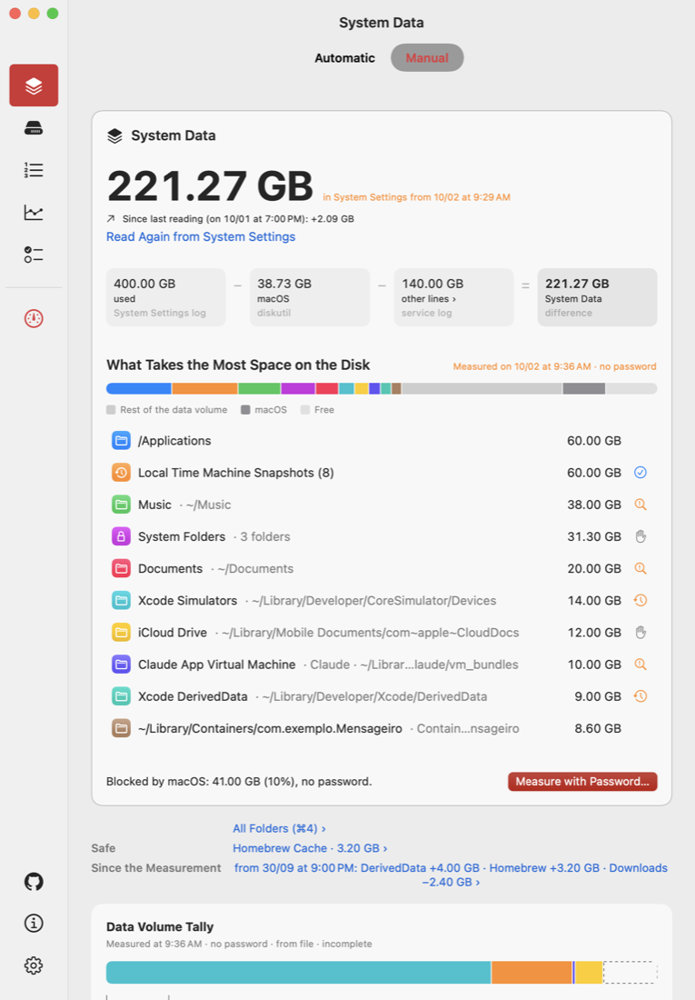
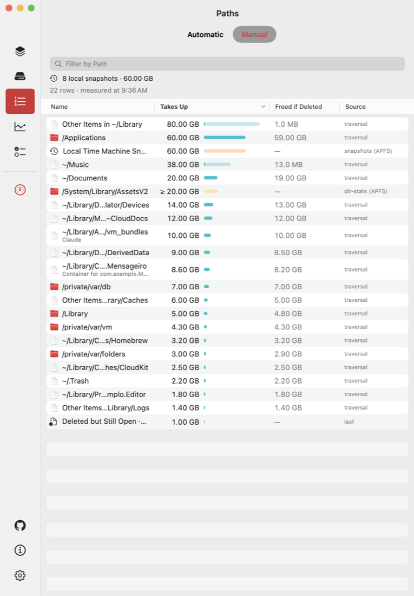
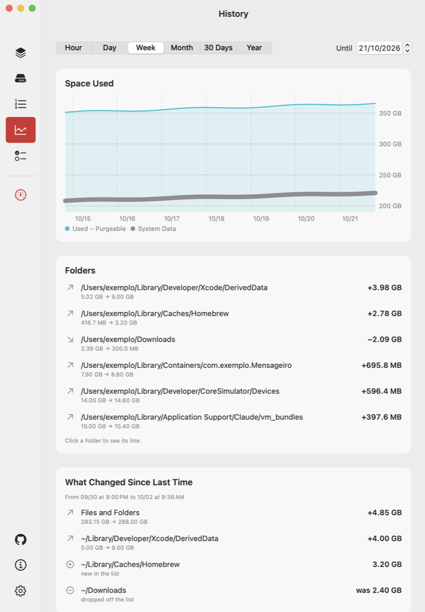
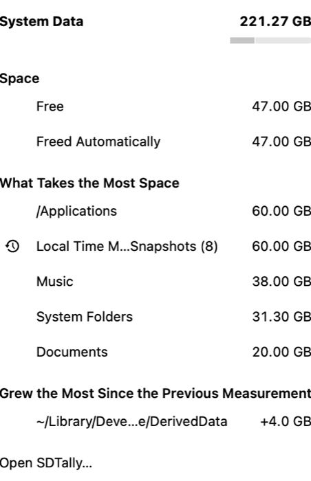

# SDTally

Explains what makes up **System Data** in macOS Storage settings by measuring it, never estimating. Read-only: it never deletes anything, never moves anything to the Trash and never uses the network.

[](https://github.com/guiselig/sdtally/actions/workflows/ci.yml)
[](LICENSE)
[](https://github.com/guiselig/sdtally/releases)
[](#requirements)

SDTally has two parts that share one measuring engine:

- **`sdtally`**, a command-line tool written in Rust. It does all the measuring and prints text or JSON.
- **SDTally.app**, a SwiftUI app that runs the embedded `sdtally` and shows the results: a live view, a full measurement, history, recommendations, a menu bar icon and exports.

## Contents

- [Screenshots](#screenshots)
- [Why System Data is opaque](#why-system-data-is-opaque)
- [What SDTally measures, and how](#what-sdtally-measures-and-how)
- [Features](#features)
- [Requirements](#requirements)
- [Install](#install)
- [First run and permissions](#first-run-and-permissions)
- [Automatic vs Full measurement](#automatic-vs-full-measurement)
- [CLI usage](#cli-usage)
- [JSON output, AI agents and MCP](#json-output-ai-agents-and-mcp)
- [Privacy and safety guarantees](#privacy-and-safety-guarantees)
- [How it works](#how-it-works)
- [Languages](#languages)
- [Limitations and FAQ](#limitations-and-faq)
- [Building from source](#building-from-source)
- [Project layout](#project-layout)
- [Documentation](#documentation)
- [Contributing, security, license](#contributing-security-license)

## Screenshots

| System Data | Largest folders |
|---|---|
|  |  |

| History | Menu bar |
|---|---|
|  |  |

## Why System Data is opaque

System Settings > General > Storage sorts files into Applications, Documents, Photos, Music, Developer, macOS and so on. **System Data is not a real category.** It is the remainder: everything the classifier did not assign elsewhere. There is no folder called "System Data" on disk, so there is nothing to open and look at. In practice it is mostly `~/Library`, plus local snapshots, swap, open-but-deleted files and APFS overhead.

Most cleaners scan a fixed list of known cache folders. That fails in both directions:

- **False positives.** They report space that does not exist (sparse disk images and cloud placeholders look like gigabytes and occupy almost nothing) or remove caches that are still in use.
- **False negatives.** They miss the real cause when it is not on their list. The audit that started this project found its largest single item to be roughly 19 GB of video files that a code editor's language server had copied into a `bin/` folder. No category-based cleaner would have looked there.

SDTally takes the opposite approach: measure the whole Data volume, explain each measured part in plain language, and show what is left over as "unexplained", with the reason it could not be measured.

## What SDTally measures, and how

Every number comes from a system call, an Apple API, a system log, or exact arithmetic on measured numbers. When the system does not provide a value, SDTally shows "not measured" with a reason, never a guess and never a zero.

| What | How it is measured | Why it matters |
|---|---|---|
| Used space of the Data volume | `ATTR_VOL_SPACEUSED` via `getattrlist` | The total that has to be explained |
| Files and folders | Parallel traversal with `getattrlistbulk`, counting **allocated blocks**, not apparent size | A 100 GB sparse VM disk can occupy 2.5 GB |
| APFS clones | Physical extents (`F_LOG2PHYS_EXT`), so shared blocks are counted once | Deleting one copy of a clone frees little or nothing |
| Hard links | Deduplicated by (device, inode) | Firmlinks and hard links would otherwise count twice |
| Cloud placeholders (dataless files) | Detected by flag, never opened, never downloaded | 70 GB of iCloud or OneDrive stubs can occupy 0 bytes |
| Large extended attributes | `listxattr` | Space that does not show up as file size |
| Local snapshots | Private size per snapshot via `fsctl`, Time Machine state via `tmutil` and its preferences | Deleted files can stay on disk inside a snapshot |
| Open-but-deleted files | `lsof` and `proc_pidfdinfo`, per process | Space comes back only when the process closes the file |
| Protected folders | APFS directory statistics (`dir-stats`) for folders the traversal cannot open | Lets a non-root run still account for them |
| APFS metadata | IOKit `AppleAPFSUserClient` node counts (a floor) | Volume overhead that is not a file |
| Purgeable space | CacheDelete, per service | "Available" in Settings is free plus purgeable |
| APFS containers and volumes | `diskutil` and DiskArbitration | The macOS line in Settings is the sum of separate volumes |
| Swap | `sysctl vm.swapusage` | Lives on the VM volume |
| The Settings screen itself | The Storage pane's own log lines, read with `log show` | Lets SDTally put its numbers next to Apple's |
| Trash by age | `ATTR_CMN_ADDEDTIME` (when an item entered the Trash) | Modification date says nothing about when it was trashed |
| Owning app of a folder | App bundles, container xattrs, app-group entitlements, folder names that match an installed app | "Whose is this?" with the evidence named |

The result is an account that closes: **used = sum of measured terms + unexplained**. The CI checks this invariant on real runs on macOS 15, 26 and 27.

Before reading anything, `sdtally` turns off two side effects for its own process with `setiopolicy_np`: materializing dataless files (so reading never triggers a cloud download) and access-time updates (so reading never writes metadata). If either call fails, it aborts.

More detail: [Understanding System Data](https://github.com/guiselig/sdtally/wiki/Understanding-System-Data) in the wiki.

## Features

### App

| Section | What it shows |
|---|---|
| **System Data** | The System Data number from Settings, broken down into what takes the most space, with the source of every number and what is still unexplained |
| **Disk** | The whole internal disk: containers, volumes (System, Preboot, Recovery, VM, Data), free space, purgeable space, snapshots, swap |
| **Largest Folders** (sidebar: Paths) | The ranking of the measurement, with the owning app of each folder. Double-click a folder to see its children, and so on |
| **History** | Used space and System Data over time (hour to year), saved full measurements, and "What Changed Since Last Time" |
| **Recommendations** (What to Do) | Advice generated by fixed rules from what was measured. Each item says what it is, whose it is, what is lost if removed, whether macOS cleans it on its own, and the next step. Some items offer "Copy command" for a command from a fixed list; the app never runs it |

Also in the app:

- **Automatic mode** (live, no password) and **Manual** mode (the latest Full Measurement), switched in the header or with ⌘← and ⌘→. See [Automatic vs Full measurement](#automatic-vs-full-measurement).
- **Passwordless Root**, an optional root helper approved once in Login Items, so full measurements do not ask for the administrator password every time. See [the wiki page](https://github.com/guiselig/sdtally/wiki/Passwordless-Root-helper).
- **Menu bar icon** that can show free space, the amount freed automatically, or just the icon. The app keeps running in the background with the window closed.
- **Notifications** when the disk grows 10 GB in a day or has less than 10 percent free (optional).
- **Export JSON** (⌥⌘E) and **Export PDF** (⌘E). The save dialog has "Replace Personal Names (Recommended for Sharing)", on by default.
- **Open at Login**, configurable refresh intervals, and an in-app language picker.
- **See New Versions** in Settings opens the GitHub Releases page in your browser. The app itself never checks for updates.
- **Info** shows the paths of the app, the embedded `sdtally`, the helper and the data folder, plus ready-to-copy commands for AI agents.

### CLI

- The full breakdown of the Data volume, as text or JSON (`sudo sdtally`, `sdtally --json`).
- A quick reading with no scan (`--quick --json`).
- Children of any folder by unique allocated size, with "freed if deleted" (`sdtally <path>`).
- Raw attributes of one file or folder (`sdtally why <path>`).
- A live tree driven by FSEvents (`--auto`), one JSON line per change.
- A cross-check against Apple's own commands (`--verify`).
- Read access to the measurements the app saved (`--last`, `--history`, `--changes`) and an MCP server for AI agents (`--mcp`).

## Requirements

| | |
|---|---|
| Mac | Apple Silicon |
| macOS | 15 (Sequoia) or later. CI runs on macOS 15, 26 and 27 |
| Account | An administrator account for the full measurement, Passwordless Root and reading the Settings log |
| Permission | Full Disk Access (for the app, or for your terminal app when using the CLI) |

## Install

### Option 1: download the app

1. Download `SDTally-<version>.dmg` from [Releases](https://github.com/guiselig/sdtally/releases).
2. Open the disk image and drag `SDTally` to Applications.
3. Open it. The app is **not notarized** by Apple, so the first launch is blocked. Open **System Settings > Privacy & Security** and click **Open Anyway**.

The `sdtally` CLI ships inside the app at `SDTally.app/Contents/Helpers/sdtally`. The app's Info section shows the exact path. To use it from a shell:

```sh
"/Applications/SDTally.app/Contents/Helpers/sdtally" --help
```

### Option 2: build from source

`cargo build --release` builds the CLI alone; `app/montar.sh` builds and signs the whole app. See [Building from source](#building-from-source).

### Uninstall

Quit the app. In Settings, remove Passwordless Root first if you installed it (or use **Measurement > Remove Passwordless Root**). Then delete `SDTally.app` and, if you want to remove saved measurements, `~/Library/Application Support/SDTally`.

## First run and permissions

On first launch the app shows a short welcome sheet (also under **SDTally > Welcome and Tips**). Nothing is requested until you click it.

| Permission | What it is for | Without it | Where |
|---|---|---|---|
| **Full Disk Access** | Lets SDTally read folders macOS hides even from administrators, such as Mail, Messages and Safari | Those folders stay blocked and the measurement is marked incomplete | System Settings > Privacy & Security > Full Disk Access. The app has an "Open Privacy & Security" button |
| **Administrator password** | A full measurement as root, so every folder can be opened | Measurement runs without root and is marked incomplete | macOS asks for it each time you choose **Measure with Administrator Password…** (⌘R) |
| **Passwordless Root** (optional) | Measures as root without asking for the password each time | Each full measurement asks for the password and cannot be stopped midway | Settings > Install… and then approve it once in System Settings > General > Login Items |

During a measurement macOS may also ask about Desktop, Documents and Downloads. For the CLI, grant Full Disk Access to your terminal app instead.

Step-by-step: [First run and permissions](https://github.com/guiselig/sdtally/wiki/First-run-and-permissions).

## Automatic vs Full measurement

| | Automatic | Full Measurement (Manual) |
|---|---|---|
| Runs | Continuously while the app is open | Once, when you ask (⌘R) |
| Engine | `sdtally --auto` | `sdtally --json` |
| Password | None | Administrator password, or none with Passwordless Root |
| How it stays current | One full pass, then re-reads only the folders FSEvents reports | Point in time |
| Granularity | Per folder (totals only) | Per file |
| Largest files | No | Yes (files of 100 MB or more, up to 30) |
| Protected folders | Not opened (unless "Automatic with root" is on) | Opened, as root |
| Extended attributes | Not measured | Measured |
| Saved to History | Hourly samples of the largest folders, kept 90 days | Each measurement is saved as a file |

In Settings > Advanced you can switch Automatic to **With Root**, which needs Passwordless Root. Automatic then reads the whole disk as root and the Automatic | Manual switch disappears. The app explains the trade-offs before you turn it on: a root process keeps running while the app is open, anyone using the session can see the size of other users' folders, and each pass costs more CPU and battery.

Details: [Automatic vs Full measurement](https://github.com/guiselig/sdtally/wiki/Automatic-vs-Full-measurement).

## CLI usage

Grant Full Disk Access to your terminal app first. `sdtally` writes nothing to disk, not even a cache. Text goes to stdout, progress goes to stderr only when stderr is a terminal.

```sh
sudo sdtally                        # the full breakdown of the Data volume
sdtally                             # works without sudo, marked INCOMPLETE with what is missing
sdtally --top 30 --binary           # 30 ranking lines; GiB instead of decimal GB
sudo sdtally --json > tally.json    # JSON on stdout (schema below)
sdtally ~/Library --top 10          # children of a folder by unique allocated size
sdtally ~/Library --depth 2         # two levels below
sdtally why ~/.colima               # raw attributes: allocated, private, clone, flags, xattrs, dir-stats
sdtally --quick --json              # the Settings screen, used, free, purgeable; no scan
sdtally --verify                    # compare used, swap and snapshots with df, sysctl and tmutil, now
sdtally --lang en                   # pt or en; default comes from LC_ALL, LC_MESSAGES or LANG
```

Notes:

- The System Data line comes from the Storage pane's log, which keeps the value for less than about 21 hours. Open **System Settings > General > Storage**, let it finish loading, then run `sdtally`.
- Ctrl-C stops the scan and prints the partial report, marked INCOMPLETE (interrupted). The exit code is 130.
- No color when `NO_COLOR` is set or stdout is not a terminal, unless `--color always`.
- `sdtally` only measures paths on the Data volume. A path on another volume is refused.
- Among the largest files, the full measurement marks sparse files (a VM disk that appears as 64 GB but takes 12 GB) and compressed files, with the logical size next to the allocated one.
- The full measurement also looks for identical copies of large files (100 MB or more): same size, then the first and last MiB, then every byte. Clones and hard links are not counted, cloud-only files are never read, and the comparison stops at 20 GB read or 60 seconds. It only recommends; it never deletes.

A shortened example of the text output (synthetic data from the test suite):

```text
System Settings screen (reproduced)                             GB   source
  macOS (Σ CapacityInUse − Data)                             39.82   diskutil

Data volume                                                 150.00   getattrlist
  What takes the most space (5 of 5 paths)
    ~/Music                                                  38.28   scan
    ~/Library/Mobile Documents/com~apple~CloudDocs           36.12   scan
    Local snapshots (8)                                      32.18   fsctl
    /private/tmp                                              4.13   scan
    APFS metadata                                             1.65   IOKit APFS
  Blocked by macOS                                           19.88
      difference (13.25% of used; includes what was not measured)

Why space may not come back (measured only)
  Local snapshots (8)                                        32.18   fsctl
    A local snapshot still holds the blocks of files you deleted: the space only
    comes back when the snapshot is gone.
```

### Modes

| Command | What it does | Root |
|---|---|---|
| `sdtally` | Full breakdown of the Data volume | Recommended (`sudo`); without it the report is INCOMPLETE |
| `sdtally <path>` | Children of a folder by unique allocated size, with "freed if deleted" | Not needed |
| `sdtally why <path>` | Raw attributes of a file or folder | Not needed |
| `sdtally --quick --json` | What changes all the time: Settings screen, used, free, purgeable, containers, swap. No scan | Not needed |
| `sdtally --quick --json --watch` | Follows the Settings log (`log stream`) and writes one JSON line per new screen, until stdin closes | Not needed |
| `sdtally --auto` | Live tree: one full pass, then only folders FSEvents reports. One JSON line per change of 10 MB or more, until stdin closes | Optional (the app's helper runs it as root) |
| `sdtally --last --json` | The newest full measurement saved by the app | Refuses root |
| `sdtally --history --json` | A summary of every saved full measurement, oldest first | Refuses root |
| `sdtally --changes --json` | What changed between the two newest saved full measurements (used, System Data, terms and folders that moved 100 MB or more) | Refuses root |
| `sdtally --mcp` | MCP server over stdio for AI agents | Refuses root |
| `sdtally --redact names --stdin` | Redacts a measurement JSON read from stdin (up to 20 MB) | Not needed |
| `sdtally --catalog --json` | The explanation cards and how each data source was checked | Not needed |
| `sdtally --verify [--json]` | Checks used, swap and snapshots against Apple's commands, now. Exit 0 if nothing is outside, 1 if something is | Refuses root |

### Options

| Option | Meaning | Default |
|---|---|---|
| `--top N` | Ranking lines in text output (JSON always has the full ranking) | 15 |
| `--depth N` | Levels below the path in branch mode | 1 |
| `--json` | JSON on stdout | off |
| `--quick` | Quick mode, no scan (requires `--json`) | off |
| `--since EPOCH_SECONDS` | With `--quick`: read the Settings log only from that moment on, and only while the Storage pane is open | off |
| `--parts LIST` | With `--quick`: read only `meta`, `volumes`, `swap`, `uso`, `purgeable`, `tela` (comma-separated); other keys are left out | all |
| `--watch` | With `--quick --json`: follow the Settings log | off |
| `--binary` | GiB (2^30) instead of GB (10^9) | GB, as in Settings |
| `--lang pt\|en` | Language of text output and messages | from `LC_ALL`, `LC_MESSAGES` or `LANG` (`pt*` gives pt, anything else en) |
| `--color auto\|always\|never` | Color | `auto` (only on a terminal and without `NO_COLOR`) |
| `--redact names\|off` | Replace the user name and personal folder names in measurement JSON | on only with `--mcp` |
| `-V`, `--version` | Print the version | |
| `-h`, `--help` | Print help | |

Invalid combinations exit with code 2 and a message. Full reference: [CLI reference](https://github.com/guiselig/sdtally/wiki/CLI-reference).

## JSON output, AI agents and MCP

`sdtally --json` writes one JSON document to stdout (`schema_version: 1`, keys in English). Bytes are integers or `null`, never `0` in place of "not measured". Every measured value carries a `state` (`measured`, `partial`, `not_measured`, `not_available`), a `reason` and a `source`. The schema is documented in [docs/json-schema.md](docs/json-schema.md) (Portuguese) and summarized in English in the wiki: [JSON output](https://github.com/guiselig/sdtally/wiki/JSON-output).

For AI agents, these commands never run as root and never measure as administrator. The full measurement comes from what the app saved.

```sh
sdtally --quick --json --redact names    # the quick reading, no root
sdtally --last --json --redact names     # the newest full measurement the app saved
sdtally --history --json                 # a summary of all saved measurements
sdtally --changes --json                 # what changed between the two newest
claude mcp add sdtally -- sdtally --mcp  # MCP server over stdio
```

If you installed only the app, use the embedded binary, for example `"/Applications/SDTally.app/Contents/Helpers/sdtally" --mcp`. The app's Info section has these commands ready to copy with the right path.

The MCP server exposes four tools, without arguments: `quick`, `last_measurement`, `history` and `what_changed`. Over MCP:

- The user name and personal folder names are replaced before anything leaves `sdtally` (`--mcp --redact off` turns this off). Known folders such as `~/Library/Caches` and app identifiers stay visible. Numbers are never changed and rows are never merged.
- Control, bidirectional and invisible characters in strings that come from disk are escaped, and those strings are cut at 256 characters. The fields `path`, `name`, `process`, `creator`, `reason` and `error` hold text from disk and are marked as data, never instructions.
- Every tool description says: read-only, advice is for the human, never run an advice command without explicit user confirmation.
- `sdtally` does not use the network, but your AI client does. What you send to an AI goes to its provider. The local history stays unredacted.

## Privacy and safety guarantees

These are design rules, enforced by tests and CI where possible.

- **Measurement only, no estimates.** Every number comes from a syscall, an API, a log or exact arithmetic on measured numbers. What the system does not report is shown as unexplained or not measured, with the reason.
- **Recommends, never deletes.** Neither the app nor the CLI deletes, moves to Trash or changes your files. The person executes the recommendation. A test (`tests/nunca_apaga.rs`) fails the build if production Rust or Swift code contains a delete or trash API, except for an exact, listed count of deletions of SDTally's own files (old saved measurements and the helper's temporary copy of the binary).
- **No network.** CI fails if networking APIs (`URLSession`, `NWConnection`, `NWListener`, `socket(`, `TcpStream`, `UdpSocket`) appear in the sources. "See New Versions" only opens a web page in your browser.
- **Never touches dataless files' contents**, so it never triggers cloud downloads, and never updates access times.
- **Never recommends** touching `/System` or `/Library` outside an explicit list, never recommends disabling SIP, and recommends removing Time Machine local snapshots only through Apple's tool (`tmutil`).
- **Every category shown explains** what it is and what happens if it is removed.
- **No scareware.** A check (`scripts/g9.sh`, also in CI and tests) bans words such as "junk", "danger", "speed up" or "clean now" in user-facing text, red colors and badges outside narrow exceptions, and toggles in the recommendations screen.
- **Redaction for sharing.** Exports and AI output can replace the user name and personal folder names. The app's own saved data stays local and unredacted.

Full page: [Privacy and safety](https://github.com/guiselig/sdtally/wiki/Privacy-and-safety).

### Design requirements

Each requirement comes from a real mistake observed in the audit that started the project.

| # | Requirement | Mistake it prevents |
|---|---|---|
| 1 | Measure allocated blocks (`stat %b`), never apparent size (`%z`) | Reporting 100 GiB for a sparse disk that occupies 2.5 GiB |
| 2 | Detect dataless files (cloud placeholders) | Reporting 77 GiB of stubs that occupy 0 |
| 3 | Check for active sync before calling a cache disposable | Corrupting a chat backup that is uploading to iCloud |
| 4 | Scan dotfiles in the home folder | Missing `~/.ollama`, `~/.npm`, `~/.colima` |
| 5 | Explain each item in plain language | "19 GiB in redhat.java" is not actionable |
| 6 | Deduplicate by `(device, inode)` | Firmlinks make `/Applications` count twice |
| 7 | Treat `Preferences` over 100 MB as an anomaly | Ignoring 4.5 GiB of assets in a folder meant for `.plist` files |
| 8 | Recognize orphaned trash folders (`CloudStorage/*/.Trash`) | Ignoring gigabytes already discarded that still occupy disk |
| 9 | Defer to the owning app (Music, Photos, Mail) | Corrupting a library by deleting files underneath it |
| 10 | Count once per group of APFS clones | Promising space that will not be freed |

## How it works

```text
SDTally.app (SwiftUI, runs as you)
  │  runs the embedded Contents/Helpers/sdtally and reads its JSON:
  │    --quick --json [--since S] [--parts P]   periodic quick reading
  │    --quick --json --watch                   follows the Settings log
  │    --auto                                   Automatic mode (live tree)
  │    <path> --json                            drill-down in Largest Folders
  │    --redact names --stdin                   redacted exports
  │    --catalog --json                         explanation cards
  │
  ├─ Full Measurement with password:
  │    osascript "with administrator privileges" ──► sdtally --json (root)
  │
  └─ Full Measurement / Automatic with Passwordless Root:
       XPC ──► SDTallyHelper (LaunchDaemon via SMAppService, root)
                 accepts only the same-team signed app and admin users,
                 copies sdtally to a root-only folder, verifies its signature,
                 runs the copy with fixed arguments: --json or --auto
```

- **`sdtally`** (Rust, `src/`) does all measuring and all arithmetic. The app does not compute numbers; it stores and displays what `sdtally` returned.
- **The app** (`app/Sources/SDTally`) runs the embedded binary and decodes its JSON.
- **The helper** (`app/Sources/SDTallyHelper`) is optional. It runs only `sdtally --json` or `sdtally --auto`, for the user of the XPC connection. Its security model is described in [SECURITY.md](SECURITY.md) and in [the wiki](https://github.com/guiselig/sdtally/wiki/Passwordless-Root-helper).
- **`sdc-coleta`** (`src/bin/sdc-coleta.rs`) is a separate research collector that writes an anonymized JSON report. It is not part of the app. Usage (pt-BR): [docs/sdc-coleta.md](docs/sdc-coleta.md).

### Where data is stored

Everything the app saves lives in `~/Library/Application Support/SDTally`:

| Path | Contents | Retention |
|---|---|---|
| `Medicoes/YYYY-MM-DD-HHMM.json` | The raw stdout of each full measurement (how it ran is kept in an extended attribute, so the file stays identical to stdout) | Up to 100 files or 50 MB; the newest is always kept |
| `pontos.jsonl` | One point per hour of the quick reading: total, used, free, purgeable, System Data | 400 days |
| `pastas.jsonl` | Hourly samples of the largest folders from Automatic | 90 days |
| `auto.json` | The last line of Automatic, so the app opens with numbers while a new pass runs | Overwritten |

The CLI writes nothing. `--last`, `--history` and `--changes` only read `Medicoes/`, skipping symlinks, files over 20 MB and files with an unexpected schema. **File > Show Saved Measurements in Finder** opens the folder.

## Languages

- **App:** 36 languages (the macOS localizations): Arabic, Catalan, Chinese (Simplified and Traditional), Croatian, Czech, Danish, Dutch, English, Finnish, French, German, Greek, Hebrew, Hindi, Hungarian, Indonesian, Italian, Japanese, Korean, Malay, Norwegian Bokmål, Polish, Portuguese (Brazil and Portugal), Romanian, Russian, Slovak, Slovenian, Spanish (Spain and Latin America), Swedish, Thai, Turkish, Ukrainian, Vietnamese. By default it follows the system; Settings > Appearance lets you pick one for SDTally only (applies after reopening). Right-to-left languages are supported.
- **CLI text output and messages:** Portuguese (Brazil) and English (`--lang`).
- **JSON:** keys and `advice[].text` in English. Explanation cards and "why space may not come back" texts carry translations into the same 36 languages.

## Limitations and FAQ

**Why are the numbers different from Finder or Settings?** Finder and Settings show apparent sizes and decimal GB. SDTally counts allocated blocks, counts a shared clone block once, and shows a dataless placeholder as 0 on disk. Settings also subtracts things it considers purgeable. SDTally puts Apple's number next to its own and labels the source of each.

**I deleted something and the space did not come back.** Common measured causes: a local snapshot still holds the blocks, an app still has the deleted file open, the file was an APFS clone sharing blocks with another file, it was a cloud-only placeholder, or it went to the Trash. The "Why space may not come back" block lists only the causes that were measured at 1 GB or more.

**The System Data line says "no record".** The number only exists in the Storage pane's log, which keeps it for less than about 21 hours. Open System Settings > General > Storage, wait for it to finish loading, and run again. The app can also open System Settings out of sight to refresh it (every 10 minutes while the app is open by default; see Settings > Automatic Refresh).

**Why is there an "unexplained" or "Blocked by macOS" line?** It is used space minus everything measured. It shrinks with root and Full Disk Access; it never goes negative (if parts overlap, it becomes "not measured" with the overlap reported).

**Why is the app not notarized?** Notarization requires a paid Apple Developer membership. The app is signed with an Apple Development certificate. Use "Open Anyway" once, or build it yourself.

**Does it work on Intel Macs or macOS 14?** No. Apple Silicon and macOS 15 or later only.

**Can I use it on an external disk?** No. SDTally measures the boot Data volume. External Trash folders (`/Volumes/*/.Trashes`) are not scanned.

**Will it clean my Mac?** No. It explains and recommends. You decide and act, in Finder or in the owning app.

More: [FAQ](https://github.com/guiselig/sdtally/wiki/FAQ).

## Building from source

Requirements: Apple Silicon, macOS 15+, Rust stable (edition 2024), and Xcode 27 for the app (older Xcode versions fail to compile it; the built app runs on macOS 15+).

```sh
# CLI
cargo build --release                 # binaries: target/release/sdtally and sdc-coleta
cargo test --release                  # unit tests, a 100,000-buffer parser test, APFS fixture (hdiutil, no root)
cargo clippy --release --all-targets -- -D warnings

# App
swift test --package-path app         # app tests with synthetic fixtures
app/montar.sh                         # builds sdtally, the app and the helper, assembles and signs SDTally.app
app/montar.sh --abrir                 # same, then opens it

# Anti-scareware check (also run by CI)
sh scripts/g9.sh
```

`app/montar.sh` writes the app to `~/Library/Caches/sdtally-build/SDTally.app` (override with `SDTALLY_BUILD`). It signs with the first **Apple Development** identity in your keychain; a free Personal Team certificate works (Xcode > Settings > Accounts > Manage Certificates > + > Apple Development). Set `SDTALLY_ASSINATURA` to pick a specific identity. Without any identity it signs ad hoc: the app runs, but **Passwordless Root cannot register** and Full Disk Access is lost on every rebuild.

If the repository lives in iCloud Drive, set `CARGO_TARGET_DIR` outside it so `target/` is not synced.

Details: [Building from source](https://github.com/guiselig/sdtally/wiki/Building-from-source).

## Project layout

| Path | Contents |
|---|---|
| `src/` | The Rust library and engine: traversal (`walk/`), data sources (`sources/`), system bindings (`sys/`), report and text output (`report/`), advice rules (`conselho.rs`), explanation cards (`catalogo.rs`), redaction (`redigir.rs`), MCP (`mcp.rs`), translations (`traducoes/`) |
| `src/bin/sdtally.rs` | The CLI entry point and argument parsing |
| `src/bin/sdc-coleta.rs` | Research collector (anonymized report) |
| `tests/` | Rust integration tests, fixtures and golden text output |
| `app/Sources/SDTally/` | The SwiftUI app and `Localizable.xcstrings` |
| `app/Sources/SDTallyHelper/` | The root helper (LaunchDaemon) |
| `app/Sources/SDTallyXPC/` | The app–helper XPC contract and signing requirement |
| `app/Tests/` | App tests and synthetic fixtures |
| `app/montar.sh` | Builds and signs `SDTally.app` |
| `scripts/` | `g9.sh` (anti-scareware check), `publicar.sh` (release), `audit.sh` (read-only shell audit), `medir-recursos.sh` (resource measurement) |
| `docs/` | Storage model, measurement pitfalls, platform restrictions, target catalog, JSON schema, specs (Portuguese) |
| `research/` | Research notes and experiments behind each decision (Portuguese) |
| `runbooks/` | Manual procedures: full audit, duplicates, iCloud sync check, VS Code storage bloat (Portuguese) |

Comments and identifiers in the code are in Portuguese.

## Documentation

- Wiki: [Home](https://github.com/guiselig/sdtally/wiki) · [Installation](https://github.com/guiselig/sdtally/wiki/Installation) · [CLI reference](https://github.com/guiselig/sdtally/wiki/CLI-reference) · [JSON output](https://github.com/guiselig/sdtally/wiki/JSON-output) · [Understanding System Data](https://github.com/guiselig/sdtally/wiki/Understanding-System-Data) · [FAQ](https://github.com/guiselig/sdtally/wiki/FAQ)
- In the repository (Portuguese): [storage model](docs/01-modelo-de-armazenamento.md), [measurement pitfalls](docs/02-armadilhas-de-medicao.md), [platform restrictions](docs/03-restricoes-de-plataforma.md), [target catalog](docs/04-catalogo-de-alvos.md), [JSON schema](docs/json-schema.md), [research synthesis](research/2026-09-27-sintese.md).

## Contributing, security, license

- Contributing: [CONTRIBUTING.md](CONTRIBUTING.md)
- Security issues: [SECURITY.md](SECURITY.md). Please report privately, not in public issues.
- License: [GPL-3.0-or-later](LICENSE). Copyright (C) 2026 Guilherme Selig. You may use, study, modify and redistribute it; if you distribute a modified version, you must publish its source under the same license.
